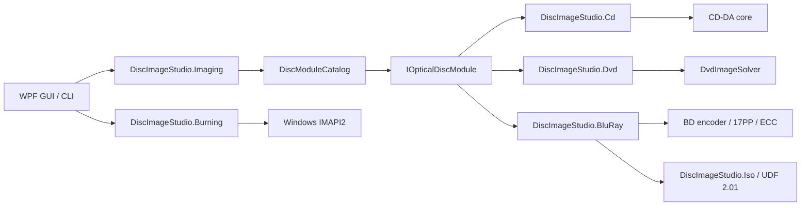

#  [EN] 

##  [EN] 

 [EN] Optical Disc [EN] 。CD、DVD、Blu-ray [EN] 、 [EN] 、sectors [EN] ， [EN] ， [EN] Error [EN] “ [EN] ” [EN] 。

## Core  [EN] 

`DiscImageStudio.Core`  [EN]  WPF、CD、DVD  [EN] ， [EN]  `net10.0`  [EN] 。

- `IOpticalDiscModule`： [EN] 。
- `DiscModuleDescriptor`： [EN]  ID、 [EN] 、Cancel [EN] 。
- `DiscCommandDescriptor`： [EN] 、 [EN] ， [EN] 。
- `DiscJobRequest`： [EN] 。
- `DiscJobProgress`： [EN] 、 [EN] 、completed [EN] 。
- `DiscJobResult`： [EN] 、 [EN] path。
- `DiscModuleCatalog`： [EN] 、 [EN] 。
- `ToneProfile` / `ToneDither`：CD/DVD/BD  [EN] Tone [EN] （Dither [EN] 、Grayscale [EN] 、Brightness、sRGB  [EN] ） [EN] OK [EN] Dither [EN] 。CD/DVD  [EN] bytes [EN] Dither， [EN]  CD Delayed interleaving [EN] ；BD  [EN] ， [EN] 、Burn [EN] 。

`OpticalDiscFamily`  [EN] （`CompactDisc`/`Dvd`/`BluRay`） [EN] ； [EN] 、 [EN] 、Design、 [EN] 、Export、Burn [EN] calibration [EN] 。

Disc Media [EN]  Core  [EN]  `disc-presets.json`（schema 4） [EN] ：`cdPresets`、`dvdPresets`、`bluRayPresets`  [EN] ， [EN] 。 [EN]  schema 2/3  [EN]  BD  [EN] Save [EN] 。

##  [EN] 

`DiscImageStudio.Core.ProjectJsonStore`  [EN]  `.discproj`（UTF-8 JSON，schemaVersion 2）： [EN] 、 [EN] （CD/DVD/BD）、 [EN] （CD r0/r1/sectors；DVD  [EN] Track Pitch [EN] ；BD  [EN]  32 sectors [EN] 、Single Layer [EN]  ≤60 mm）、 [EN] 、 [EN] 、 [EN]  `tone` Tone [EN] 、 [EN]  `bluRay` polarity [EN] 、calibration [EN] path [EN] Save [EN] 。`tone`  [EN] ；schemaVersion 1  [EN]  CD/DVD  [EN]  2  [EN] 。BD  [EN]  `bluRay.invertMapping`  [EN]  BD  [EN] ，CD/DVD  [EN] 。 [EN] ， [EN]  JSON  [EN] 。 [EN] path [EN] ， [EN] 。

 [EN] ： [EN] （ [EN] ， [EN] New/Open、 [EN] Recent [EN] ） [EN] ——Design /  [EN]  / Export / Burn / calibration（`Workspace`  [EN] ， [EN] ）。 [EN] ， [EN] ： [EN]  `DiscParametersState`，Open Project [EN]  `ProjectSession`  [EN] ，Save [EN] ； [EN] 、Export、Burn、calibration [EN]  State  [EN] 。 [EN]  State  [EN] 。

 [EN] Custom [EN]  chrome  [EN]  `WindowWorkArea`  [EN] ： [EN]  `WM_GETMINMAXINFO`  [EN] （ [EN] 、 [EN]  DPI） [EN] / [EN] ， [EN] 、 [EN]  DPI  [EN] ； [EN]  `SystemParameters.WindowResizeBorderThickness`  [EN] 。

 [EN] ： [EN] （`PageHeader`） [EN] ** [EN] **（`StageBar`，Design →  [EN]  → Export → Burn │ calibration， [EN] 、 [EN] 、 [EN] ） [EN] 「 [EN] 」 [EN] 。 [EN]  `NavigateTo`： [EN] ， [EN]  `CurrentWorkspace`  [EN] ， [EN] 、 [EN] ， [EN] 。

 [EN] ：`MonitorCard`（ [EN] ： [EN]  +  [EN]  +  [EN]  +  [EN] ， [EN] ， [EN] Status [EN] ） [EN] calibration [EN] ；`StepCard`（ [EN] ：Status [EN]   [EN] / [EN] /Completed +  [EN] ） [EN] calibration [EN] ， [EN] 、 [EN] ；`VisibilityGate`（ [EN] ） [EN] / [EN] ， [EN]  DataTrigger  [EN] ；`PathField`、`SourceChip`  [EN] path [EN] 、 [EN] ；`EmptyStateCard`（ [EN]  +  [EN]  +  [EN] ） [EN] 。 [EN] ： [EN] / [EN]  `CardHeaderBandStyle`  [EN] （MonitorCard、Design [EN] ）， [EN] ； [EN]  15px。`SourceChip`  [EN]  `Actions`  [EN] 「 [EN] 」 [EN] ， [EN] 「 [EN]  +  [EN] 」 [EN] 。 [EN] ： [EN] / [EN]  Compact  [EN] （36 px）， [EN] standard [EN] （44 px）， [EN]  `SidePanelWidth`（280） [EN] 。

 [EN] ， [EN]  72 px  [EN] （ [EN] 、 [EN] ）， [EN] 「About」 [EN] ； [EN] 。

`DesignView`  [EN]  `CalibrationView`  [EN] ： [EN] （ [EN]  `ScrollViewer`  [EN] / [EN] ， [EN] 、DPI  [EN] pixels [EN] Status）； [EN] 、 [EN] （Design [EN]  < 900  [EN] ，calibration [EN]  < 990）。Design [EN] ， [EN] 。Design [EN] “ [EN]  + Tone” [EN] ， [EN]  `ScrollViewer`  [EN] ； [EN]  < 900  [EN] 。Tone [EN] （`TonePanel`） [EN]  UserControl， [EN]  280 px  [EN] disc surface +  [EN] ， [EN] disc surface、 [EN] （ [EN] ， [EN]  `x:Name` cannot [EN] ）。

 [EN]  `PreviewInspectorViewModel`  [EN] ： [EN]  CD、DVD、BD  [EN] （`ArtifactPath`、`ArtifactLabel`、`MeasuredInnerRadius`、`PreviewSize`、`SamplesPerSector` …）。 [EN] —— [EN] ，Open Project [EN]  `SetDiscType`  [EN] ， [EN] ， [EN] 。 [EN] （ [EN] ） [EN]  `DiscParametersState`  [EN] ； [EN] 「Deinterleaved」 [EN] ， [EN]  `CdInterleave`， [EN] audio track（ [EN]  sidecar） [EN] interleaving [EN] ；BD  [EN] Samples per sector [EN] 。 [EN] （measured [EN] Track Pitch、 [EN] ） [EN] ， [EN] 「measured [EN] （ [EN] ）」 [EN] 。BD  [EN]  sidecar， [EN] Total sectors、 [EN] 、 [EN] 、polarity [EN] Tone； [EN]  sidecar  [EN]  ISO  [EN] 。

 [EN] ：

- ** [EN] **（r0、r1、sectors、DVD  [EN] Track Pitch） [EN] Project Settings [EN] 。 [EN] （`GeometrySummary`） [EN] 「 [EN] …」 [EN] ， [EN] 。
- **Disc Media [EN] ** [EN] ， [EN] ：New Project [EN] （ [EN] directory [EN] ）。Project Settings [EN] —— [EN] ， [EN] 「 [EN] Save [EN] 」， [EN]  JSON（ [EN] ，Save [EN] directory [EN] Refresh）。
- ** [EN] **：Export [EN] （ [EN] path、CUE、interleaving、ISO/ [EN] folder/ [EN] ），Burn [EN] （ [EN] 、Recorder [EN] ）。 [EN] Export [EN] ， [EN] Disc Media [EN] ；Burn [EN]  CD/DVD  [EN] （ [EN] calibration [EN] ）， [EN] Error [EN] 。Burn [EN] 「 [EN] 」 [EN] （ [EN] 「Design [EN]  /  [EN] 」 [EN] ）： [EN] ， [EN] Assisted Calibration [EN] calibration [EN] ； [EN] 。
- **Tone** [EN] ， [EN] Design [EN] ：Dither [EN] （0–100%， [EN]  75%）、sRGB  [EN] （Gamma）、CD  [EN] Grayscale [EN] （2/4  [EN] ；DVD/BD  [EN]  2  [EN] ） [EN] Brightness（±64） [EN]  `tone`  [EN] ， [EN] 、streamingBurn、 [EN] calibration [EN]  `ToneProfile`。BD  [EN]  3T/6T polarity [EN] ， [EN]  `bluRay.invertMapping`， [EN]  `ToneProfile`。 [EN] disc surface [EN] ， [EN] ；Export [EN] NoticeTone [EN] Design [EN] ， [EN] 。
- ** [EN] **（measured [EN] 、Export [EN] 、Samples per sector） [EN] ， [EN] 。Open Project [EN] measured [EN] ，Design [EN] ； [EN] measured [EN] deviation， [EN] calibration [EN] 。

Design [EN] （`DesignViewModel` + `DiscDesignCanvas` + `DesignComposer`） [EN] ： [EN] （ [EN]  0， [EN] ， [EN] ）， [EN] mm [EN] / [EN] / [EN] ； [EN] ， [EN] 。 [EN]  450 ms  [EN]  `DesignComposer`  [EN] （ [EN]  2048 px，Export 8192 px）： [EN] ， [EN]  2 ×  [EN] Outer Radius（CD  [EN]  57.5 mm，DVD/BD  [EN] Outer Radius）。 [EN]  State  [EN] path， [EN] Export [EN] ； [EN]  CLI  [EN] 。Export [EN] Burn [EN] path [EN] Export [EN]  8192 px  [EN] ， [EN] Disc Media [EN] 。 [EN] 「 [EN] 」 [EN]  Design →  [EN]  → Export → Burn，calibration [EN] Burn [EN] 。

Design [EN]  `Themes/Tokens.xaml`（ [EN] 、 [EN] 、 [EN]  `RadiusChip`/`RadiusPanel`/ [EN] 、 [EN] 、`SidePanelWidth`、 [EN] 、 [EN] 、 [EN] ） [EN]  `Themes/Controls.xaml`（ [EN] 、 [EN] 、 [EN] 、 [EN] 、 [EN] 、`DangerCard`  [EN] 、 [EN] ）。 [EN]  `Controls/Motion.cs`  [EN] ，Custom [EN]  `Controls/DiscTheme.cs`  [EN]  `Controls/DiscRenderCore.cs`  [EN] ， [EN] 。`Controls.xaml`  [EN] （`BasedOn="{StaticResource {x:Type X}}"`）must [EN] ： [EN] ， [EN]  Windows  [EN] ， [EN] 。 [EN] （ [EN]  `MonitorCard`） [EN] Custom [EN]  UserControl：UserControl  [EN] ， [EN]  `x:Name`  [EN] ， [EN] 。

##  [EN] 

`DiscImageStudio.Imaging`  [EN] ， [EN]  `RingImageQuality`：Design [EN] （8192 px） [EN] ， [EN] Design [EN] 、Export [EN] 。 [EN] disc surface [EN] （ [EN] 、 [EN] 、 [EN] ） [EN] Design [EN]  `DesignComposer`  [EN]  mm  [EN] completed，Export/Burn/ [EN] ， [EN] 。

## streamingBurn [EN] 

CD  [EN]  `OpticalBurnRequest.ProduceContent`  [EN]  44.1 kHz、16  [EN] 、 [EN]  PCM，`ContentLength`  [EN] 。CD  [EN] ， [EN]  IMAPI  [EN]  `CdAudioByteOrder.LittleEndian`； [EN] Delayed interleavingcompleted [EN] sectors [EN] 。 [EN]  `.wav` / `.raw`  [EN] ：WAV  [EN] ， [EN]  44 bytes RIFF  [EN]  WAVE CUE； [EN]  RAW  [EN] 。Windows RAW  [EN] measured [EN] bytes， [EN] bytes [EN] 。 [EN]  [CD Burn [EN] ](CD_AUDIO_COMPATIBILITY.md)。

`DiscImageStudio.Burning`  [EN]  Windows IMAPI2  [EN] 、 [EN] 、COM `IStream`  [EN] 、64 MiB  [EN] （ [EN]  32 MiB） [EN] Burn [EN] 。 [EN]  CD/DVD Burn [EN] Disc Media [EN] ， [EN] ； [EN] Burn [EN] 。CD/DVD  [EN] ：CD  [EN]  2352 bytes [EN] sectors，DVD  [EN]  2048 bytes [EN] sectors。Burn [EN] ， [EN] 。 [EN] ，failed [EN] 。

DVD  [EN] folder [EN] ： [EN] directory，OK ISO9660/Joliet  [EN] 、 [EN]  extent  [EN]  LBA； [EN] disc surface [EN] ，Inner Ring [EN] “ [EN]  →  [EN]  →  [EN] ”，Outer Ring [EN] “ [EN]  →  [EN]  →  [EN] ”。 [EN]  16 sectors ECC Block  [EN] 。 [EN] Save [EN] ， [EN] ， [EN]  Seek  [EN] 。

BD-R  [EN] Burn [EN] ：`BluRayIsoGenerator`  [EN]  UDF 2.01、 [EN] ；Outer Ring [EN] ， [EN]  32 sectors [EN] 。Burn [EN]  MMC  [EN] ， [EN]  25 GB  [EN] 。BD  [EN] spare area [EN] ； [EN] Disc Media [EN] 。

`ProjectOutputs.FilesAtOuterRing`  [EN] ， [EN]  `false`，DVD/BD  [EN] Status [EN] Export、 [EN] Burn。 [EN]  GUI  [EN] ， [EN] ； [EN] 。 [EN]  sidecar  [EN] ， [EN] directory [EN] 。

##  [EN] 

### CD

`DiscImageStudio.Cd`  [EN]  CD  [EN] 、 [EN] 、RAW  [EN] Delayed interleaving。 [EN] Cancel， [EN] bytes [EN]  `DiscJobProgress`。

### DVD

`DiscImageStudio.Dvd`  [EN] 。 [EN] 、 [EN] ， [EN]  `DvdImageSolver`。DVD  [EN] 。

### Blu-ray

`DiscImageStudio.BluRay`  [EN]  BD  [EN] 、17PP、EDC/Reed-Solomon/LDC-BIS、3T/6T run-count  [EN] 、streaming [EN]  ISO  [EN] ， [EN]  `DiscImageStudio.Iso`  [EN]  UDF 2.01。 [EN]  Core  [EN]  GUI  [EN] ， [EN]  CD/DVD  [EN] 。BD  [EN]  `ToneProfile`  [EN] ，`BluRayRunLengthMapping`  [EN]  128  [EN] polarity [EN] ； [EN]  ISO  [EN]  `bd-r-image-v1` sidecar， [EN] sectors、 [EN] 、 [EN] 、polarity、Tone [EN]  UDF  [EN] 。

##  [EN] 

1.  [EN]  ID  [EN] must [EN] ，directory [EN] 。
2.  [EN]  GUI  [EN] Status； [EN]  `DiscJobRequest`。
3.  [EN] ； [EN] 、 [EN] 。
4.  [EN] cannot [EN] Cancel，`SupportsCancellation` must [EN]  `false`。
5.  [EN] ； [EN]  Core。
6.  [EN] must [EN] directory [EN] 。
